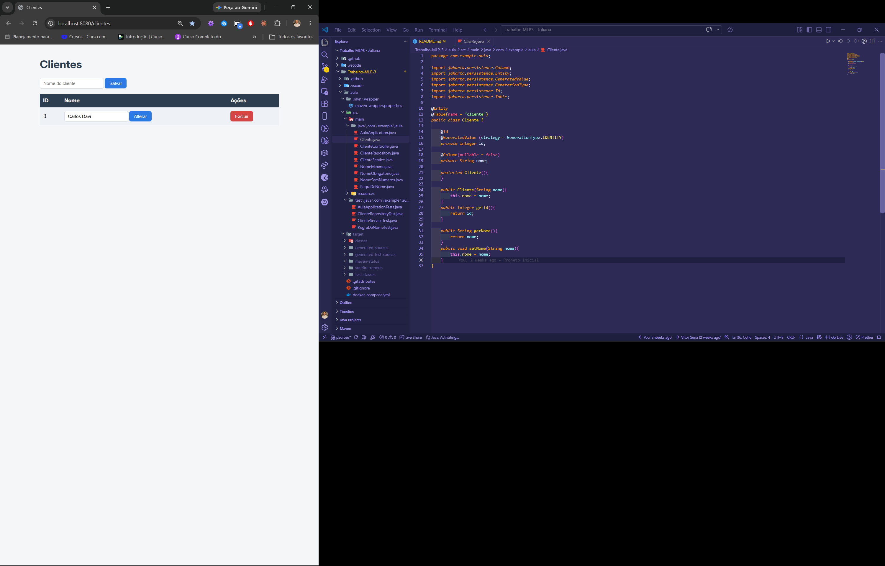

# PROJETO GRÁFICO COM JAVA + SPRINGBOOT


## Sobre o projeto

- **O que é:** É um sistema de listagem de clientes para uma loja de sapatos, na qual eles poderam consultar quais clientes comprou na loja naquele determinado dia.
- **Para quem:** Seria para lojas, lanchonetes e todo ambito administrativo.
- **Por que foi feito:** trabalho do 2º bimestre de Modelos e Linguagem de Programação III, Multivix Vitória, 2026/2.

## Equipe

| Integrante | Parte desenvolvida | O que fez |
| --- | --- | --- |
| Henrique Langa | Ex.: Padroes de projeto e boas práticas | Uso das Regras Obrigatorias do projeto |
| Jhon Wesley | Ex.: interface | Interface web para a manipulação dos dados |
| Vitor Sena | Ex.: Dados - Parte inicial & Testes Unitários| Aplicação do JPA e MySQL no projeto & Teste com Junit5 e Mockito para saber se existe alguma falha de classes|


## Temas do bimestre

| Tema | Como foi aplicado | Onde está no código |
| --- | --- | --- |
| Classes de manipulação de dados de BD | Ex.: entidade `Cliente` e `ClienteRepository` com Spring Data JPA | `src/main/java/.../Cliente.java`, `ClienteRepository.java` |
| Interface web | Explique como a página, o controller e o serviço (ou repositório) se ligam | `src/main/java/.../ClienteController.java` e `src/main/resources/templates/clientes.html` |
| Padrões de projeto e boas práticas | Qual padrão foi applied, por quê, e o que melhorou no código | Classe(s) e pacote(s) onde o padrão aparece |
| Teste unitário | O que foi testado e com que ferramenta (JUnit) | `src/test/java/...` |

## Tecnologias Utilizadas

<p align="left">
  
  
  
  
  
  
  
  
</p>

## Estrutura do projeto

```text
projeto/
├── docker-compose.yml
├── pom.xml
└── src/
    ├── main/
    │   ├── java/com/example/aula/
    │   │   ├── Cliente.java
    │   │   ├── ClienteRepository.java
    │   │   └── ...
    │   └── resources/
    │       ├── application.properties
    │       └── templates/        (somente se a interface for web)
    └── test/java/com/example/aula/
```

## Imagem do projeto




 ## Autores

**Equipe Henrique Langa| John Wesley| Vitor Sena | Turma SIN05NA/SIN06NA | Multivix Vitória - 2026/2 |  Professora: Juliana Rodrigues de Lima Meirelles.**


## OBS: MySQL RODADO EM DOCKER 